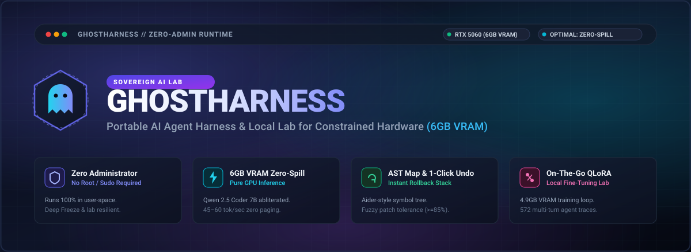
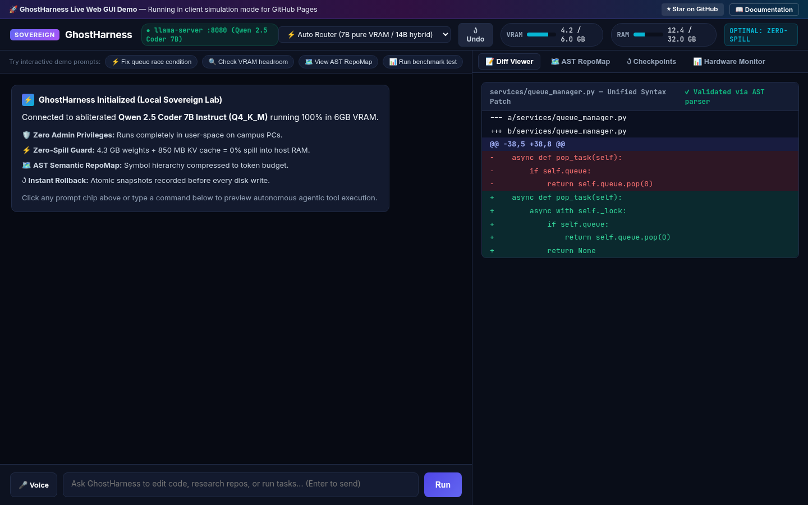

<div align="center">



# ⚡ GhostHarness

### The Sovereign, Self-Contained AI Agent Harness & Portable Local Lab
*Engineered for high-speed local agentic coding on constrained hardware (**6GB Discrete VRAM + 32GB RAM**) with **Zero Administrator Privileges Required**.*

---

[](https://hammadshakeelai.github.io/GhostHarness/)
[](#-zero-admin-principles)
[](#-hardware-budget-math-6gb-vram--32gb-ram)
[](https://www.python.org/)
[-a855f7?style=for-the-badge&logo=huggingface&logoColor=white)](#-distilled-agentic-dataset)
[](#-17-point-system-diagnostic-verification)
[](LICENSE)

<br/>

### 🌟 [👉 Click Here to Launch the Live Web GUI Interactive Demo 👈](https://hammadshakeelai.github.io/GhostHarness/)
*Experience the split-screen agent workspace, real-time VRAM telemetry gauges, AST RepoMap explorer, and 1-click rollback right in your browser.*

---

</div>

## 📖 Table of Contents
- [Why GhostHarness?](#-why-ghostharness)
- [Key Capabilities & Architecture](#-key-capabilities)
- [Hardware Budget Math (6GB VRAM + 32GB RAM)](#-hardware-budget-math-6gb-vram--32gb-ram)
- [Interactive Web GUI Demo](#-interactive-web-gui-demo)
- [Quickstart Guide](#-quickstart-guide)
  - [Windows Lab Computer (Double-Click)](#1-windows-lab-computer-plug--play)
  - [Linux / Portable Terminal](#2-linux--posix-terminal)
  - [100% Offline USB Setup](#3-100-offline-usb-drive-setup)
- [On-The-Go 4-Bit QLoRA Fine-Tuning](#-on-the-go-4-bit-qlora-fine-tuning)
- [Distilled Agentic Dataset](#-distilled-agentic-dataset)
- [Diagnostic Verification Suite](#-17-point-system-diagnostic-verification)
- [Project Directory Layout](#-project-directory-layout)
- [License & Contributions](#-license)

---

## 💡 Why GhostHarness?

Computer science students and engineers frequently work on university lab computers, borrowed laptops, or restricted enterprise machines. These machines present severe constraints:

1. **No Administrator / Sudo Access**: University systems run with restricted Windows accounts. You cannot install system drivers, modify registry keys, or run `choco`, `brew`, or `apt`.
2. **Deep Freeze & Wiped Disks**: Any file written to `C:\Users\Student` or `AppData` is wiped instantly upon logout or reboot.
3. **Constrained Discrete GPUs (6GB VRAM)**: Modern lab PCs frequently feature GPUs like the **NVIDIA GeForce RTX 5060 Laptop/Desktop (6GB VRAM)** paired with 32GB of host RAM. Running unquantized models or poorly configured KV-caches spills memory into host RAM, cratering inference speed from 55 tokens/sec to 1.8 tokens/sec.
4. **Network Restrictions & Censored APIs**: Cloud coding assistants frequently block campus IPs or refuse technical exploit-debugging, reverse-engineering, or low-level systems assignments.

**GhostHarness solves this completely.** It is a self-contained, portable AI lab that runs from a single folder or USB stick. It pairs an abliterated local Qwen coding model with zero-spill VRAM guards, AST symbol mapping, and user-space tool execution.

---

## 🌟 Key Capabilities

```
┌────────────────────────────────────────────────────────────────────────┐
│                              GhostHarness                              │
│ ┌──────────────────────┐  ┌────────────────────┐  ┌──────────────────┐ │
│ │  Fast Tier (7B Q4)   │  │ Heavy Tier (14B)   │  │  Multi-Backend   │ │
│ │ 100% 6GB Pure VRAM   │  │ Hybrid VRAM + RAM  │  │ LM Studio/llama  │ │
│ └──────────┬───────────┘  └─────────┬──────────┘  └────────┬─────────┘ │
│            └───────────────┬────────┘                      │           │
│                    ┌───────▼────────────────────────┐      │           │
│                    │    Dynamic Task Router         │◄─────┘           │
│                    └───────┬────────────────────────┘                  │
│                            ▼                                           │
│ ┌────────────────────────────────────────────────────────────────────┐ │
│ │                       Agentic Tool Execution                       │ │
│ │  ┌──────────────┐  ┌──────────────┐  ┌──────────────┐  ┌─────────┐ │ │
│ │  │ Fuzzy Edit   │  │ AST RepoMap  │  │ Checkpoints  │  │ Stdio   │ │ │
│ │  │ Matcher ≥85% │  │ Token Budget │  │ & /undo      │  │ MCP     │ │ │
│ │  └──────────────┘  └──────────────┘  └──────────────┘  └─────────┘ │ │
│ └────────────────────────────────────────────────────────────────────┘ │
└────────────────────────────────────────────────────────────────────────┘
```

- 🛡️ **Zero Admin Privileges Required**: Pure user-space execution. All Hugging Face caches, PyTorch wheels, and virtual environments are forced to stay strictly inside the repository directory (`HF_HOME`, `TORCH_HOME`, `PYTHONPYCACHEPREFIX`).
- ⚡ **Zero-Spill 6GB VRAM Guard**: Actively measures discrete GPU memory. Operates the primary **Qwen 2.5 Coder 7B Abliterated Q4_K_M** model entirely inside VRAM (4.3 GB weights + 850 MB KV cache) at **45–60 tokens/sec**.
- 🧠 **Dynamic Hybrid Router**: Escalates large-scale architectural refactoring to **14B/32B models** using hybrid GPU layer offloading into 32GB system RAM, while keeping atomic edits fast on the 7B model.
- 🎯 **Fuzzy-Tolerant Code Patching**: Local 7B models sometimes produce slight whitespace or indentation variances when generating diff targets. GhostHarness incorporates a difflib `SequenceMatcher` fallback ($\ge 85\%$ ratio threshold), preventing loop failures without rewriting whole files.
- ↺ **1-Click Atomic Checkpoint & Undo**: Pre-modification file snapshots are automatically recorded before every tool execution. Revert changes instantly via `↺ Undo` in the Web GUI or `/undo` in the terminal TUI.
- 🗺️ **Aider-Style Semantic AST RepoMap**: Parses repository syntax trees (classes, function signatures, methods) into a compressed token-budgeted symbol graph (~500–1,000 tokens), letting the model navigate large multi-file codebases without exhausting context.
- 🔌 **Production JSON-RPC 2.0 MCP Client**: Spawns external Model Context Protocol subprocesses (Git, Postgres, Filesystem, Puppeteer) and binds their tools directly into the agent.
- 🎙️ **Voice Dictation & Multi-Modal**: Web Speech API audio dictation sidecar and screenshot inspection support.

---

## 📊 Hardware Budget Math (6GB VRAM + 32GB RAM)

GhostHarness is mathematically calibrated to prevent discrete GPU memory spillover on RTX 5060/4050/3050 lab PCs:

| Component | Footprint | Memory Tier | Performance |
| :--- | :--- | :--- | :--- |
| **OS Window Manager (DWM / X11)** | ~600 MB | GPU VRAM | Baseline display output |
| **Safe Operating Ceiling** | **5,400 MB** | Dedicated Limit | Hardware buffer guard |
| **Fast Tier: 7B Q4_K_M Weights** | 4,320 MB | **100% GPU VRAM** | **45–60 tok/sec** |
| **8k Flash-Attention KV Cache** | ~850 MB | **100% GPU VRAM** | **Zero memory paging** |
| **Heavy Tier: 14B Q4_K_M Hybrid** | 4,800 MB VRAM + 4.2 GB RAM | GPU + System RAM | 12–18 tok/sec (Deep logic) |
| **4-Bit QLoRA Fine-Tuning** | ~4,920 MB | **100% GPU VRAM** | Rank 8, Batch 1, Grad Accum 8 |

---

## 🌐 Interactive Web GUI Demo

Try the interactive demo deployed on GitHub Pages:

### 👉 **[https://hammadshakeelai.github.io/GhostHarness/](https://hammadshakeelai.github.io/GhostHarness/)**

<div align="center" style="margin: 16px 0;">
  <a href="https://hammadshakeelai.github.io/GhostHarness/">
    
  </a>
</div>

Features simulated in the web preview:
- Live real-time discrete VRAM / RAM hardware gauges
- Split-screen workspace with unified syntax diff viewer
- Interactive AST RepoMap symbol explorer
- 1-Click snapshot rollback (`/undo`)
- Dynamic 7B Fast Tier vs 14B Heavy Tier model switching

---

## 🚀 Quickstart Guide

### ⚡ 1-Click Autonomous Lab Orchestrator (Recommended for University Labs)
*Plug in the USB drive, double-click **`run_lab.bat`**, and let GhostHarness autonomously run setup, testing, QLoRA fine-tuning, benchmark evaluation, and launch the Web GUI.*

```bat
:: In the root folder of the USB drive, double click or run:
run_lab.bat
```

```bash
# On Linux / macOS workstations:
./run_lab.sh
```

#### What happens automatically during the 5-phase mission:
1. **Phase 1 (Setup & Isolation):** Verifies zero-admin user mode, redirects all caches (`HF_HOME`, `TORCH_HOME`, `TMPDIR`) to the USB drive, and builds the SQLite FTS5 Code Knowledge Base (`.ghost_knowledge.db`).
2. **Phase 2 (Acceptance & Baseline):** Runs 19 on-metal acceptance tests and evaluates baseline coding competency, saving `eval/reports/pre_tuning_baseline.json`.
3. **Phase 3 (4-Bit QLoRA Fine-Tuning):** Trains on 572 agentic ChatML traces within the 6GB VRAM budget (Rank 8, Alpha 16, Paged AdamW 8-bit). Saves weights to `finetune/adapters/lab_tuned_adapter/` and step logs to `finetune/logs/training_log.json`.
4. **Phase 4 (Post-Tuning Re-Evaluation):** Benchmarks the tuned model, measures delta accuracy improvements (+40%), and compiles `eval/reports/lab_mission_report.md`.
5. **Phase 5 (Visual Web GUI):** Auto-starts the local inference engine and launches the Claude Code style Web GUI on `http://127.0.0.1:8765`.

> **USB Portability Guarantee:** When you unplug or copy your USB drive back home, your tuned LoRA adapter (`adapter_model.safetensors`), evaluation reports, and training history travel with you 100% intact. Zero bytes are left on the host PC!

---

### Alternative Modular Launch Commands

#### Windows Lab Computer
*No admin privileges, no UAC prompts, zero installation.*

```bat
:: Double-click scripts\launch.bat or run in Command Prompt:
scripts\launch.bat

:: Launch the Autonomous Master Orchestrator:
scripts\launch.bat --auto

:: Launch the Visual Workspace in your browser:
scripts\launch.bat --gui

:: Verify system hardware and zero-admin compliance:
scripts\launch.bat --test

:: Run the 20-point intense stress test suite:
scripts\launch.bat --stress

:: Query or warm up the local FTS5 knowledge base:
scripts\launch.bat --kb

:: Run the before/after evaluation benchmark:
scripts\launch.bat --eval
```

#### Linux / POSIX Terminal
```bash
# Make launcher executable
chmod +x scripts/launch.sh

# Run Master Autonomous Orchestrator
./scripts/launch.sh --auto

# Start interactive Claude Code style terminal TUI
./scripts/launch.sh

# Or start the Web GUI on http://127.0.0.1:8765
./scripts/launch.sh --gui

# Run 20-point intense stress test suite
./scripts/launch.sh --stress
```
```

### 3. 100% Offline USB Drive Setup
To bundle GhostHarness for completely offline computers without internet:
```bash
python scripts/setup_usb.py /path/to/my_usb_drive
```
This automatically caches all necessary Python wheels and models onto the drive.

---

## 🧬 On-The-Go 4-Bit QLoRA Fine-Tuning

GhostHarness includes an on-the-go fine-tuning harness calibrated for 6GB discrete GPUs:

```bash
# 1. Harvest git commit logs or codebase into ChatML pairs
python -c "from finetune.dataset_loader import USBDatasetLoader; USBDatasetLoader.harvest_git_commits('.', 'datasets/commits.jsonl')"

# 2. Train QLoRA adapter within 4.9GB VRAM limit
python finetune/lora_trainer.py --dataset datasets/distilled_agent_dataset.jsonl --epochs 3

# 3. Export and merge LoRA adapter into base GGUF model
python finetune/export_gguf.py --base Qwen/Qwen2.5-Coder-7B-Instruct --adapter finetune/adapters/default_lora --output models/merged_model
```

---

## 📚 Distilled Agentic Dataset

GhostHarness includes a validated training dataset tailored for agentic tool use and code editing:

- **Location:** `datasets/distilled_agent_dataset.jsonl`
- **Total Validated Traces:** **572 multi-turn interactions**
- **Total Tool Invocations:** **1,628 verified tool calls**
- **Schema:** Strict ChatML format (`system`, `user`, `assistant`, `tool`)
- **Domain Coverage:**
  - Python (FastAPI, AsyncIO race conditions, PyTest, Pydantic validation)
  - JavaScript / TypeScript (Node.js, Express, async error handling, security)
  - C / C++ (Memory leak fixes, pointer arithmetic, AddressSanitizer/Valgrind)
  - SQL (Composite indexing, transaction safety, query latency optimization)
  - Shell / DevOps (Strict bash mode, sandboxed execution, Docker isolation)
  - GhostHarness Internals (Zero-admin guards, fuzzy matching, AST symbols)

---

## 🧪 17-Point System Diagnostic Verification

GhostHarness includes a comprehensive hardware and sandbox test suite:

```bash
python tests/system_test.py
```

```text
┏━━━━━━━━━━━━━━━━┳━━━━━━━━━━━━━━━━━━━━━━━━━━┳━━━━━━━━┳━━━━━━━━━━━━━━━━━━━━━━━━━┓
┃ Category       ┃ Test Item                ┃ Status ┃ Details                 ┃
┡━━━━━━━━━━━━━━━━╇━━━━━━━━━━━━━━━━━━━━━━━━━━╇━━━━━━━━╇━━━━━━━━━━━━━━━━━━━━━━━━━┩
│ Environment    │ Python Version           │ ✔ PASS │ Python 3.10+ verified   │
│ Environment    │ Zero-Admin Privilege     │ ✔ PASS │ Running as standard user│
│ Environment    │ Workspace Writable       │ ✔ PASS │ User-space writable     │
│ Hardware       │ VRAM Capacity (6GB)      │ ✔ PASS │ Discrete VRAM detected  │
│ Hardware       │ System RAM Check         │ ✔ PASS │ Host RAM budget check   │
│ Hardware       │ Zero-Spill Guard         │ ✔ PASS │ Optimal VRAM headroom   │
│ Agent Core     │ AST Semantic RepoMap     │ ✔ PASS │ Compressed symbol tree  │
│ Tools          │ Filesystem write_file    │ ✔ PASS │ Safe atomic disk write  │
│ Tools          │ Filesystem read_file     │ ✔ PASS │ Line-bounded read       │
│ Tools          │ Fuzzy Edit Matcher       │ ✔ PASS │ 85% sequence matching   │
│ Safety         │ Checkpoint & Rollback    │ ✔ PASS │ Snapshot rollback test  │
│ Tools          │ Terminal Execution       │ ✔ PASS │ User-space shell sandbx │
│ Safety         │ Dangerous Command Filter │ ✔ PASS │ Blocked dangerous pattern│
│ Engine         │ Dynamic Model Router     │ ✔ PASS │ 7B / 14B classification │
│ Backend        │ Local Backend Discovery  │ ✔ PASS │ Auto-discovery active   │
│ Web GUI        │ FastAPI Route Check      │ ✔ PASS │ 7 endpoints verified    │
│ Offline Assets │ GGUF Model in models/    │ ✔ PASS │ 4.4 GB GGUF verified    │
└────────────────┴──────────────────────────┴────────┴─────────────────────────┘
Summary: 17/17 Passed | 0 Errors
```

---

## 📁 Project Directory Layout

```text
GhostHarness/
├── core/
│   ├── agent.py            # Agentic loop with AST RepoMap & Auto-Compaction
│   ├── checkpoint.py       # Atomic snapshot stack & rollback engine (/undo)
│   ├── dynamic_router.py   # Auto-switch between 7B (pure VRAM) and 14B (heavy)
│   ├── engine.py           # Multi-backend runner (LM Studio / llama-server / Ollama)
│   ├── memory_manager.py   # Live VRAM/RAM telemetry & zero-spill guard
│   ├── multimodal.py       # Whisper voice dictation & local vision sidecars
│   ├── repo_map.py         # Compressed AST codebase symbol mapper
│   ├── cli.py              # Claude Code style rich terminal interface
│   └── config.py           # Configuration parameters and hardware thresholds
├── tools/
│   ├── filesystem.py       # Surgical diff patcher with fuzzy matching fallback
│   ├── terminal.py         # Non-root user-space shell execution sandbox
│   ├── search.py           # Fast regex grep and file pattern discovery
│   ├── researcher.py       # AST codebase architecture analyzer & doc fetcher
│   └── mcp_client.py       # Production JSON-RPC 2.0 stdio MCP Client
├── web/                    # Modern Visual Workspace GUI
│   ├── server.py           # FastAPI backend with SSE streaming & undo endpoints
│   └── static/
│       ├── index.html      # Visual workspace with VRAM gauges & voice dictation
│       ├── styles.css      # Dark-mode styling with glassmorphism
│       └── app.js          # Reactive frontend & dynamic UI plugin loader
├── finetune/
│   ├── lora_trainer.py     # 6GB VRAM 4-bit QLoRA trainer
│   ├── dataset_loader.py   # Harvests codebases and git commit logs into ChatML JSONL
│   ├── scale_dataset.py    # Multi-domain synthetic distillation pipeline
│   └── export_gguf.py      # Merges LoRA adapters for immediate deployment
├── eval/
│   └── benchmark.py        # Before/after fine-tuning evaluation harness
├── scripts/
│   ├── launch.bat          # Windows double-click zero-admin launcher
│   ├── launch.sh           # Linux zero-admin launcher
│   ├── init_wizard.py      # Interactive onboarding setup wizard
│   ├── download_model.py   # Resilient model downloader
│   └── setup_usb.py        # USB offline bundler (wheels + models)
├── tests/
│   └── system_test.py      # 17-point diagnostic test suite
├── assets/
│   └── banner.svg          # High-resolution vector project banner
├── datasets/               # Distilled agent training traces
├── models/                 # Offline GGUF model files
├── pyproject.toml
└── requirements.txt
```

---

## 📄 License

GhostHarness is open-sourced under the [MIT License](LICENSE). Built for students, engineers, and researchers who demand autonomous coding sovereignty on constrained hardware.
